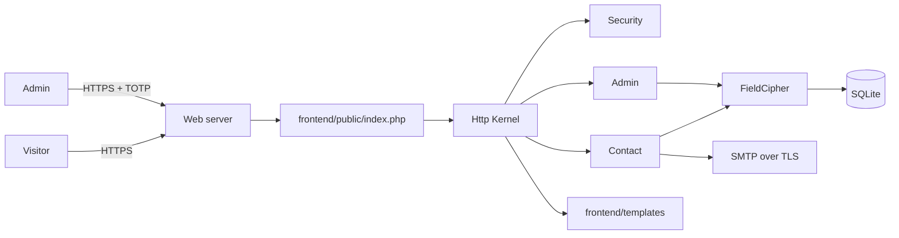

# Architecture

## Overview

The application is a framework-free, server-rendered PHP 8.4 monolith with a strict separation between the presentation layer in `frontend/` and application logic in `backend/`. Dependencies are limited to a maintained mailer and a TOTP library.



## Module structure

```text
backend/src/
  Application.php        Composition root
  Admin/                 Authentication, admin users, recovery codes, audit log
  Config/                Environment parsing and validation
  Console/               Operator commands
  Contact/               Validation, submission model, storage, intake service
  Http/                  Request, response, routing, security headers
  Mail/                  Notification port and SMTP adapter
  Persistence/           Connection settings and schema application
  Security/              Cipher, keyring, hashing, TOTP, CSRF, rate limiting, sessions
  Support/               Clock abstraction
  View/                  Template rendering and output escaping
backend/tests/
  Unit/                  Isolated module tests
  Functional/            Full request flows through the HTTP kernel
  Support/               Test doubles and harness
frontend/
  public/                Web root
  templates/             Layout, contact, admin, and error views
```

## Request flows

### Contact submission

1. The kernel enforces the body size limit and validates the CSRF token.
2. A filled honeypot ends the request with a normal-looking success response and stores nothing.
3. The per-client rate limit is applied.
4. `ContactValidator` normalizes and validates each field.
5. The submission is encrypted and stored.
6. A notification is attempted. A mail failure is recorded and does not lose the submission.
7. The browser is redirected, which prevents duplicate submissions on refresh.

### Admin sign-in

1. Password verification is rate limited by client and account and uses Argon2id. Unknown accounts perform equivalent work.
2. Success rotates the session id and creates a pending state valid for five minutes. It grants no access.
3. A TOTP code or one-time recovery code is verified. Accepted TOTP steps are recorded atomically, so a code cannot be replayed.
4. Success rotates the session id and CSRF token again. Sessions expire after 15 idle minutes or 8 hours.

## Data protection

| Data | Protection |
| --- | --- |
| Submission fields | XChaCha20-Poly1305, bound to the record id |
| TOTP secrets | XChaCha20-Poly1305, bound to the account |
| Passwords | Argon2id with a per-password random salt |
| Recovery codes | SHA-256 of 80-bit random codes, single use |
| Client addresses | Keyed HMAC in rate limit and audit tables |

Encryption keys are derived from the keyring with HKDF using separate context strings. Timestamps, notification status, key ids, and approximate ciphertext length are not encrypted.

## Recommended deployment

- Run PHP-FPM behind nginx or Caddy with TLS, and expose only `frontend/public`.
- Keep the database on persistent storage owned by the PHP user, outside the web root.
- Inject configuration through the service manager or a secret store.
- Schedule `maintenance:purge` daily.

```nginx
root /srv/contact-form/frontend/public;

location /assets/ {
    try_files $uri =404;
}

location / {
    fastcgi_pass unix:/run/php/php8.4-fpm.sock;
    include fastcgi_params;
    fastcgi_param SCRIPT_FILENAME $document_root/index.php;
}
```

## Design decisions

| Decision | Rationale | Trade-off |
| --- | --- | --- |
| SQLite | No database server for a low-volume form | Single-host writes; another engine would need a schema port |
| Encrypt the whole payload | Simple model that hides individual field sizes | Submissions cannot be searched in SQL |
| Notification without content by default | Keeps personal data out of mailboxes | The admin area is needed to read messages |
| No client-side JavaScript | Allows a CSP that blocks all scripts | No live validation in the browser |
| No file uploads | Removes the largest attack surface of the original | The unused upload handling is gone |
